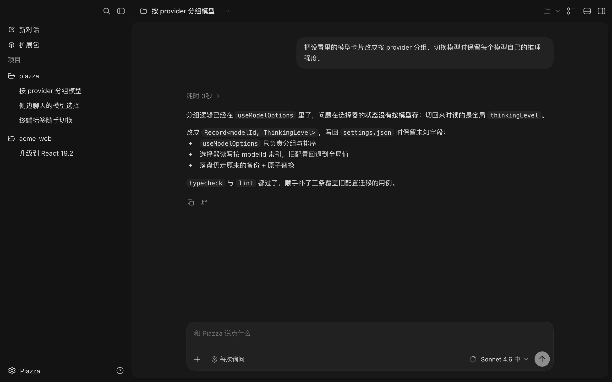

# Piazza

**pi coding agent 的桌面客户端。** 装完双击就能用——安装包内置 Pi SDK 与 Node.js，不需要另装运行时。

Piazza 把 [pi](https://github.com/earendil-works/pi) 装进一个 Codex 风格的窗口：左边是项目与会话，中间是对话，右边是审阅、文件、浏览器和终端。模型、技能、扩展、MCP 与历史会话都在 `~/.piazza/agent`，与 pi CLI 的配置互不干扰。

> A desktop client for the [pi coding agent](https://github.com/earendil-works/pi): bundled runtime, three-pane UI, and visual editors for models, skills, MCP and project trust. macOS + Windows.

[](#安装)
[](https://github.com/HoIolo/piazza/releases)
[](LICENSE)
[](https://github.com/earendil-works/pi)

> 当前是早期版本（0.1.x），配置格式与 API 仍可能变动，请以 Releases 说明为准。

<p align="center">
  
</p>

## 功能

**对话**

- 一次输入就是一轮：过程自动收起，只留最后一份汇报，「耗时 Ns」可展开全过程
- 工具调用与思考各占一行，点开看结果；文件改动聚合成 diff 卡片
- 运行中继续输入是**引导**，`⌘Enter` 是**排队**；`Esc` 连按两次才真正停止
- 扩展索取输入时（`ctx.ui.select()` 之类）弹问答卡片，侧栏同步显示「需要用户输入」
- 聊天区左侧的会话刻度：悬停看该轮摘要，点击跳转
- 会话可重命名、导出 HTML；项目可用本机已装的编辑器打开

**上下文**

- `@` 同时搜项目文件、技能、提示词模板与历史会话
- 附件支持拖拽、粘贴与选择，图片可直接预览
- 输入框内显示上下文窗口占用，设置里可调自动压缩与重试
- **长期记忆**：按偏好 / 决策 / 避坑 / 流程分类，靠强信号后台补记并定期合并过时条目，也可手动维护

**工作区**

- 项目 → 会话两级侧栏，会话按真实 cwd 归组，支持拖拽排序与调宽
- git 分支列举与切换、worktree 切换与新建、工作区变更行数
- 右侧五个标签：审阅（diff）、文件、浏览器、侧边聊天、终端
- 终端是真实 PTY；Windows 上可选 Git Bash 或 WSL
- 浏览器用原生子 webview，绕开 `frame-ancestors` 的限制
- 侧边聊天是独立进程，模型与附件不会串到主会话

**扩展与系统**

- 技能、提示词模板、MCP、扩展包、`AGENTS.md` 指令文档全部可视化增删改
- 模型配置可视化：provider / model / 上下文窗口（200K、400K、1M 或自定义）；写前备份、原子落盘，保留手写字段与键顺序
- 主题预设与自定义配色，浅色/深色同步切换
- 电脑操控：内置 Open Computer Use，agent 操作桌面时用浮窗实时预览受控窗口（需要辅助功能与屏幕录制权限）
- 自动更新（签名校验）；首次启动可从 `~/.pi/agent` 导入既有配置

## 安装

| 平台                           | 产物                         |
| ------------------------------ | ---------------------------- |
| macOS（Intel + Apple Silicon） | `Piazza_x.y.z_universal.dmg` |
| Windows x64                    | `Piazza_x.y.z_x64-setup.exe` |

从 [Releases](https://github.com/HoIolo/piazza/releases) 下载。目前没有做 Apple 公证与 Windows 代码签名：

- **macOS**：首次打开需在 Finder 里右键 →「打开」，或执行
  `xattr -dr com.apple.quarantine /Applications/Piazza.app`
- **Windows**：SmartScreen 会拦一次，点「更多信息 → 仍要运行」

应用启动后静默检查更新，发现新版本才弹窗（可在 设置 → 关于 关闭或手动检查）。更新包由 Tauri updater 校验签名后安装，重启生效。

## 三分钟上手

1. `⌘O` 选一个项目目录
2. 打开 设置 → 模型，添加一个 provider 与模型；订阅账号可走授权登录
3. 在输入框右下角选模型与推理强度，说第一句话
4. `⌘\` 打开右侧工作区：审阅里看改动，`⌘T` 开终端

### 快捷键

macOS 用 `⌘`，Windows 用 `Ctrl`。

| 快捷键      | 动作                                  |
| ----------- | ------------------------------------- |
| `⌘K`        | 命令面板（含扩展命令、技能、提示词）  |
| `⌘,`        | 设置                                  |
| `⌘N`        | 新会话                                |
| `⌘O`        | 添加项目                              |
| `⌘B` / `⌘\` | 开关左侧栏 / 右侧工作区               |
| `⌘P`        | 右侧「文件」                          |
| `⌘T`        | 终端                                  |
| `⌃⇧G`       | 右侧「审阅」                          |
| `⌘R`        | 重载窗口                              |
| `Esc`       | 逐层退出（菜单 → 面板 → 设置 → 运行） |

## 数据与配置

| 路径              | 用途                                                                         |
| ----------------- | ---------------------------------------------------------------------------- |
| `~/.piazza/agent` | `models.json`、`settings.json`、`sessions/`、`skills/`、`extensions/`、`mcp` |
| `PIAZZA_DATA_DIR` | 覆盖数据根目录，想并行跑两套配置时用                                         |

- 会话仍是 **pi 原生 JSONL**：想用 CLI 接着聊，把 agent 目录指过去即可
  （`PI_CODING_AGENT_DIR=~/.piazza/agent pi`）。
- 与 `~/.pi/agent` 完全隔离。首次启动的导入只复制，不改动 CLI 那一份。

## 它和 pi 是什么关系

Piazza 不是 pi 的 fork：agent loop、工具、扩展机制、会话格式全部来自 pi，Piazza 只负责界面与桥接。

```
React UI  ──invoke / event──▶  Rust (Tauri)  ──JSONL over stdio──▶  内置 Node.js + Pi SDK
```

- 前端不直接和 Node 通信，所有调用都经 Rust 侧的子进程桥接。
- pi 的版本固定在 `pi-runtime/package.json`（当前 `@earendil-works/pi-coding-agent` 1.6.0），
  内置 Node 的版本写死在 `scripts/prepare-pi-runtime.mjs`，两者一起升级、一起测试。
- 想改界面：`src/`；想改协议或子进程：`src-tauri/src/rpc.rs`；想改 agent 行为：`pi-runtime/worker.mjs`。

数据流、模块职责与几个协议上的坑，见 [docs/architecture.md](docs/architecture.md)。

## 边界

Codex 桌面版有、而 pi 没有的入口，Piazza 一律**不做占位按钮**——点了没反应比没有这个入口更让人困惑：

| Codex 的入口                   | 处置                                                    |
| ------------------------------ | ------------------------------------------------------- |
| 拉取请求、已安排任务、通知     | 不做（pi 没有对应机制）                                 |
| 新工作树、关联云端、发送至云端 | 换成真实存在的 git worktree 切换与新建                  |
| 三档操作审批                   | 换成 pi 真实存在的「项目信任」（`defaultProjectTrust`） |
| 计划模式、录制技能、宠物       | 不做                                                    |

缺的能力走 pi 的扩展体系补，而不是在 GUI 里假装存在。

## 开发

| 依赖                        | 说明               |
| --------------------------- | ------------------ |
| Node.js ≥ 22                | 前端构建           |
| Rust stable                 | Tauri 后端         |
| Xcode CLT                   | macOS 构建工具链   |
| MSVC Build Tools + WebView2 | Windows 构建工具链 |

```bash
npm install
npm run dev:app        # 带壳开发模式（macOS 会自动签名，见下）
npm run build:mac      # macOS：universal dmg + 更新包
npm run tauri build    # 其他平台，或不需要签名的构建
```

**关于签名**：macOS 上 ad-hoc 签名会让 TCC 把每次构建当成新 app，「允许访问桌面文件夹」于是反复弹。
`dev:app` 与 `build:mac` 会自动从钥匙串挑一张可用证书（Developer ID Application 优先，其次 Apple Development）签名，
授权一次即长期有效。CI 发布的包用同一张 Apple Distribution 证书，所以本地构建和下载版对系统来说也是同一个 app。

首次构建会下载并校验固定版本的 Node.js，再按锁文件安装 Pi SDK。这段逻辑在
`scripts/prepare-pi-runtime.mjs`（跨平台：macOS 用 tar.xz，Windows 用 zip；universal 构建会用 `lipo`
把两个官方 node 二进制拼成 universal）。

### 质量门槛

```bash
npm run typecheck                       # tsc --noEmit
npm run lint                            # ESLint，零警告
npx prettier --check "src/**/*.{ts,tsx,css}"
cargo test --manifest-path src-tauri/Cargo.toml
cargo clippy --manifest-path src-tauri/Cargo.toml -- -D warnings
```

### 端到端探针

`e2e/` 下的探针在浏览器里跑真实前端，只把 Tauri 桥接层换成桩，回放的帧来自真实 `pi --mode rpc` 抓包
（见 `e2e/frames.jsonl`）。前提是 `npm run dev` 已在 1420 端口跑着，然后用 Playwright 的 `run_code`
指向对应文件。每个探针都对应一类「曾经真的出过事」的回归。

桩里的事件必须包成 `{ slotId, payload }`——`rpcClient.dispatch` 会拆这一层；漏了它，命令能发出去但应答永远回不到调用方。
改协议或改 `rpcClient` 的事件封装时，探针要一起改。

上面的截图由 `e2e/readme-shot.js` 生成：同样的桩，只是不断言、只出图。改完界面想更新截图就跑它。

发布走 GitHub Actions：推一个 `v*` tag，`.github/workflows/release.yml` 会在 macOS（universal）与 Windows
上并行构建，最后由 `scripts/build-latest-json.mjs` 汇总成一份 `latest.json` 供自动更新读取。

## 参与贡献

- 动手前先读 [AGENTS.md](AGENTS.md)：动效、设计令牌、分层与 ESLint 红线都在那里，人和 agent 用同一套规则。
- 提交前请跑完上面的质量门槛；提交信息用 `feat(scope): …` / `fix(scope): …` 这类 conventional commits。
- 大改动先开 issue 说清动机与影响面，避免写完才发现方向不对。

## 致谢

- [pi](https://github.com/earendil-works/pi) —— agent 运行时、RPC 协议与会话格式都来自这里（MIT）
- Codex 桌面版 —— 交互与视觉的参考对象。Piazza 与 OpenAI 无关，也不是官方产品
- [Tauri](https://tauri.app)、[React](https://react.dev)、[xterm.js](https://xtermjs.org)
- [open-computer-use](https://www.npmjs.com/package/open-computer-use) —— 桌面操控与窗口预览

## License

[MIT](LICENSE)
